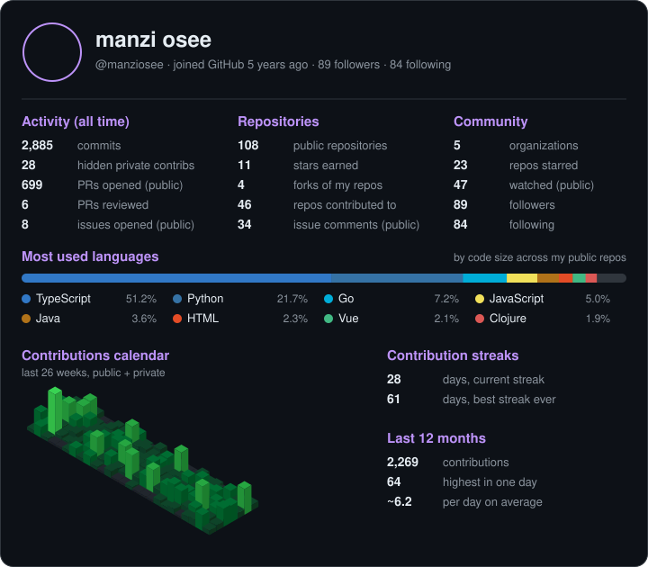

<!-- Header -->

  

  
   
  

  
  
  
  
  

  
  
  
  
  

---

<h2></h2>

With **2+ years** of experience, I build scalable, production-minded systems: payment platforms, logistics software, AI-powered backends and distributed services. When I'm not coding, you'll find me **watching anime**, gaming 🎮, or exploring new UI/UX design trends.

| | |
|:--|:--|
| 🏢 **Currently** | **SIC Rwanda** (Hybrid) |
| 🌐 **Portfolio** | [osee-portfolio.vercel.app](https://osee-portfolio.vercel.app/) |
| 📧 **Email** | [manziosee3@gmail.com](mailto:manziosee3@gmail.com) |
| 😄 **Pronouns** | He/Him |
| 🟢 **Open to work** | Yes |

---

<h2></h2>

  
   
  
   
  
    
  
  
  
  
  

---

<h2></h2>

| Area | Tools |
|:-----|:------|
| ⚙️ **Backend** | Django, FastAPI, Node.js, Spring Boot, Go, Odoo |
| 🎨 **Frontend** | React, Vue.js, Next.js, Angular, SASS, TypeScript |
| 🗄️ **Databases** | PostgreSQL, MySQL, MongoDB, Oracle, SQL Server, Redis, Supabase |
| 🤖 **AI / ML** | Python, LangChain, RAG pipelines, LLM extraction (Groq), OCR |
| ☁️ **DevOps & Cloud** | Docker, Kubernetes, Prometheus, Linux, Fly.io, Netlify, Vercel, CI/CD |
| 🔌 **API Design** | REST, GraphQL, OpenAPI, signed webhooks |
| 🏦 **Domains** | Fintech & payments, logistics & supply chain, procurement, compliance |

---

<h2></h2>

Production-style systems you can open and try right now.

<h3 align="left">💳 Fintech &amp; Payments</h3>

<table>
  <tr>
    <td width="50%" valign="top">
      <h3>🛡️ <a href="https://aegispays.netlify.app/">AegisPay</a></h3>
      <b>Multi-tenant payment operations platform</b>
        
      One workspace for finance teams to run their money operations: a <b>double-entry ledger</b>, collections and refunds, <b>maker-checker approvals</b>, bank-statement reconciliation, period close, fraud review, <b>signed webhooks</b> and a full audit trail. Supports any <b>ISO 4217 currency</b> and connects to any bank or payment provider through bank files and statements.
        
      
      
      
      
      
      
      
      
      
      
      
        
      
    </td>
    <td width="50%" valign="top">
      <h3>📈 <a href="https://finsight-api-gateway.fly.dev/docs">FinSight</a></h3>
      <b>AI-powered financial-intelligence API</b>
        
      Feed it whatever financial data a business has (bank statements, mobile money, invoices, receipts, spreadsheets, POS, payment gateways, ERP exports) in any format and currency. FinSight connects it, understands it, <b>reconciles</b> it, explains it, <b>detects anomalies</b>, predicts trends and acts on the results.
        
      
      
      
      
      
        
      
    </td>
  </tr>
</table>

<h3 align="left">🌐 Distributed Systems</h3>

<table>
  <tr>
    <td colspan="2" width="100%" valign="top">
      <h3>🛰️ <a href="https://atlas-console.netlify.app/">Atlas</a></h3>
      <b>Edge service discovery with a web console</b>
        
      A distributed service-discovery system written in <b>Go</b>. Nodes find each other through a <b>SWIM-style gossip protocol</b>, with no central database and no leader. When a node dies, the rest of the cluster knows within seconds. The <b>Atlas Console</b> shows which services are ready across every node and lets you operate them from the browser.
        
      
      
      
        
      
    </td>
  </tr>
</table>

<h3 align="left">🚚 Logistics &amp; Supply Chain</h3>

<table>
  <tr>
    <td width="50%" valign="top">
      <h3>🗂️ <a href="https://carga-flow.vercel.app/">CargaFlow DMS</a></h3>
      <b>Document management for transport & logistics</b>
        
      A metadata-driven document management system built for freight operations. Instead of folders, every document belongs to exactly one transport file, identified by a single <b>Shipment Reference</b>, so the right paperwork is always one lookup away.
        
      
    </td>
    <td width="50%" valign="top">
      <h3>🚢 <a href="https://cargaflow-tms.netlify.app/">CargaFlow TMS</a></h3>
      <b>Multi-country transport management</b>
        
      A Transport Management System for forwarders handling <b>sea, air, road, rail and multimodal</b> shipments across countries. It is integrated with <a href="https://carga-flow.vercel.app/">CargaFlow DMS</a>, so shipment records and their documents stay linked end to end.
        
      
    </td>
  </tr>
  <tr>
    <td width="50%" valign="top">
      <h3>📦 <a href="https://ware-track-pro.vercel.app/">WareTrack Pro</a></h3>
      <b>Warehouse & delivery management</b>
        
      An all-in-one solution for managing inventory, tracking deliveries and optimizing logistics operations, built for modern warehouses and distribution centers.
        
      
      
        
      
    </td>
    <td width="50%" valign="top">
      <h3>🥖 <a href="https://supply-chain-rescue-platform.netlify.app/">SupplyChain Rescue</a></h3>
      <b>Surplus-food redistribution</b>
        
      Donors (markets, bakeries, restaurants, farms) publish food that would otherwise be wasted. A <b>coordination engine</b> ranks recipient organizations (food banks, shelters, schools), splits each donation across the best matches and assigns a capable transporter. When food is within <b>six hours of expiry</b>, <b>Rescue Mode</b> allocates it automatically.
        
      
    </td>
  </tr>
</table>

<h3 align="left">🏢 Business Workflows &amp; AI</h3>

<table>
  <tr>
    <td colspan="2" width="100%" valign="top">
      <h3>🧾 <a href="https://procure-to-pay-system.vercel.app/">Procure-to-Pay System</a></h3>
      <b>Procurement with AI document processing</b>
        
      A complete procure-to-pay platform with multi-level approval workflows.
      <ul>
        <li>🔐 <b>Secure access:</b> multi-role users (Staff, Approver L1/L2, Finance), JWT auth with httpOnly refresh cookies, RBAC and optional TOTP two-factor auth with any authenticator app</li>
        <li>📋 <b>Purchase requests:</b> create, track, search, filter and paginate; approvals flow Pending → Approved/Rejected and <b>purchase orders are generated automatically</b></li>
        <li>🤖 <b>AI document processing:</b> OCR plus PDF/Word/text extraction, with Groq-powered structured extraction and validation of proformas and receipts (vendor, line items and more)</li>
        <li>🏢 <b>Vendor directory:</b> vendors are captured automatically from extracted proformas, with request count, total spend and recent activity</li>
        <li>💰 <b>Budget tracking:</b> monthly per-department limits, live spend-vs-budget on the Finance dashboard and automatic alerts when a department goes over</li>
      </ul>
        
      
      
      
      
      
        
      
    </td>
  </tr>
</table>

<h3 align="left">📡 Community Impact</h3>

<table>
  <tr>
    <td colspan="2" width="100%" valign="top">
      <h3>📡 <a href="https://internet-stability-tracker.vercel.app/">Internet Stability Tracker</a></h3>
      <b>Real-time network monitoring</b>
        
      Automatically measures internet speed, detects outages and visualizes network performance across <b>locations and ISPs</b>, giving communities transparency into their local network infrastructure.
        
      
    </td>
  </tr>
</table>

---

<h2></h2>

  

  

  <picture>
    <source media="(prefers-color-scheme: dark)" srcset="https://raw.githubusercontent.com/manziosee/manziosee/output/github-contribution-grid-snake-dark.svg" />
    
  </picture>

---

<h2></h2>

> 🔄 Auto-updated daily by GitHub Actions from my pinned repositories

<!-- PROJECTS:START -->

| Project | Tech Stack | Stars | Forks | Description |
|:--------|:-----------|:-----:|:-----:|:------------|
| [**mycadet-temp**](https://api.github.com/repos/manziosee/mycadet-temp) | TypeScript |  |  | Temporary private mirror of vellum-ai/vellum-assistant for the Cadet rebrand |
| [**atlas**](https://api.github.com/repos/manziosee/atlas) | Go |  |  | A distributed edge service-discovery system in Go. Nodes find each other through a SWIM-style gossip protocol, without a central database or a leader. When a node dies, the rest of the cluster knows within seconds. |
| [**drift-company**](https://api.github.com/repos/manziosee/drift-company) | TypeScript |  |  | website for Kuro Slide, a Tokyo drift collective. |
| [**creative-website**](https://api.github.com/repos/manziosee/creative-website) | TypeScript |  |  | website for  marketing site for an independent creative studio |
| [**quickinbox**](https://api.github.com/repos/manziosee/quickinbox) | TypeScript |  |  | Quickinbox — self-hosted web mail client on Cloudflare Workers. |
| [**dolibarr**](https://api.github.com/repos/manziosee/dolibarr) | PHP |  |  | Dolibarr ERP CRM is a modern software package to manage your company or foundation's activity (contacts, suppliers, invoices, orders, stocks, agenda, accounting, ...). it's an open source Web application (written in PHP) designed for businesses of any sizes, foundations and freelancers. |

<!-- PROJECTS:END -->

---

<h2></h2>

> 🔄 Auto-updated daily: my most starred public repos

<!-- POPULAR-REPOS:START -->
<table width="100%">
  <tr>
    <td width="50%" align="center" valign="top">
       
      <a href="https://github.com/manziosee/mycadet-temp"><b>🔷 mycadet-temp</b></a> 
      Temporary private mirror of vellum-ai/vellum-assistant for the Cadet rebrand
        
      
        
      
      
      
       
    </td>
    <td width="50%" align="center" valign="top">
       
      <a href="https://github.com/manziosee/atlas"><b>🔷 atlas</b></a> 
      A distributed edge service-discovery system in Go. Nodes find each other through a SWIM-style gossip protocol, without a central database or a leader. When a node dies, the rest of the cluster knows within seconds.
        
      
        
      
      
      
       
    </td>
  </tr>
  <tr>
    <td width="50%" align="center" valign="top">
       
      <a href="https://github.com/manziosee/drift-company"><b>🔷 drift-company</b></a> 
      website for Kuro Slide, a Tokyo drift collective.
        
      
        
      
      
      
       
    </td>
    <td width="50%" align="center" valign="top">
       
      <a href="https://github.com/manziosee/creative-website"><b>🔷 creative-website</b></a> 
      website for  marketing site for an independent creative studio
        
      
        
      
      
      
       
    </td>
  </tr>
  <tr>
    <td width="50%" align="center" valign="top">
       
      <a href="https://github.com/manziosee/quickinbox"><b>🔷 quickinbox</b></a> 
      Quickinbox — self-hosted web mail client on Cloudflare Workers.
        
      
        
      
      
      
       
    </td>
    <td width="50%" align="center" valign="top">
       
      <a href="https://github.com/manziosee/dolibarr"><b>🔷 dolibarr</b></a> 
      Dolibarr ERP CRM is a modern software package to manage your company or foundation's activity (contacts, suppliers, invoices, orders, stocks, agenda, accounting, ...). it's an open source Web application (written in PHP) designed for businesses of any sizes, foundations and freelancers.
        
      
        
      
      
      
       
    </td>
  </tr>
</table>
<!-- POPULAR-REPOS:END -->

---

<h2></h2>

🎮 Gaming &nbsp;·&nbsp; 🎨 UI/UX trends &nbsp;·&nbsp; 📚 Tech articles &nbsp;·&nbsp; 🎬 **Anime** & movies &nbsp;·&nbsp; 🏀 Basketball &nbsp;·&nbsp; ⚽ Football &nbsp;·&nbsp; 🚴 Cycling

> _"Anime taught me to never give up. Same goes for coding!"_ ✨

---

  

